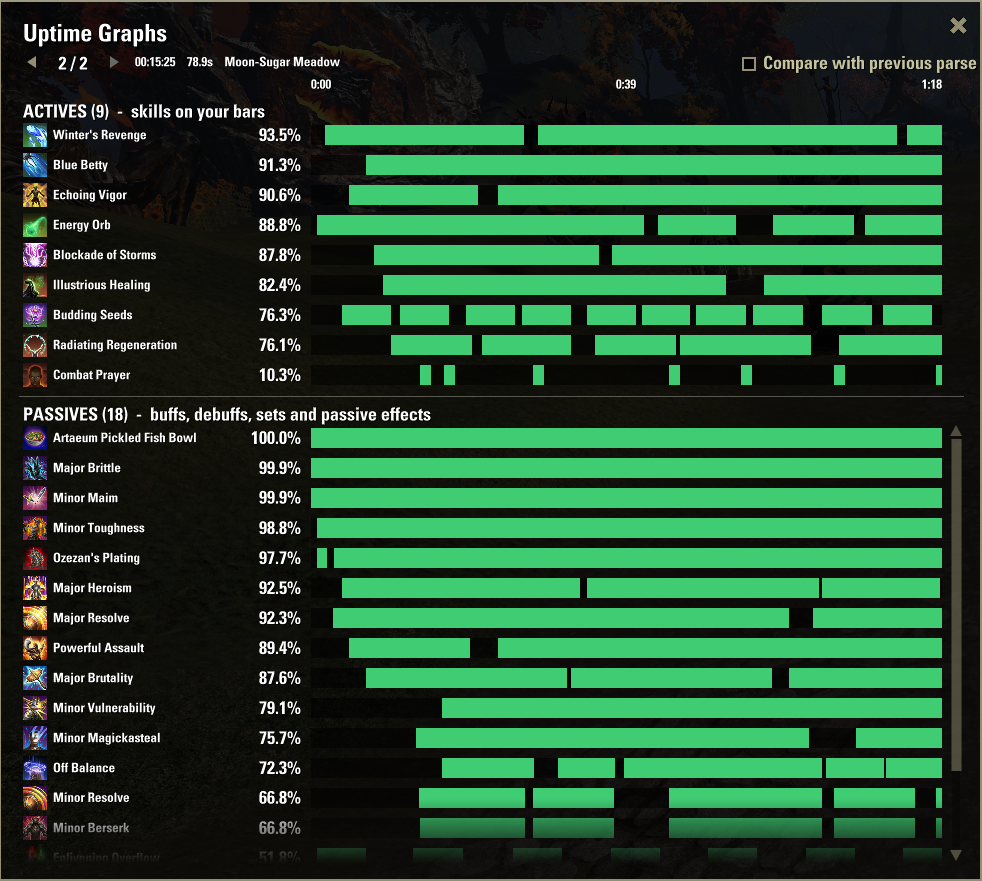
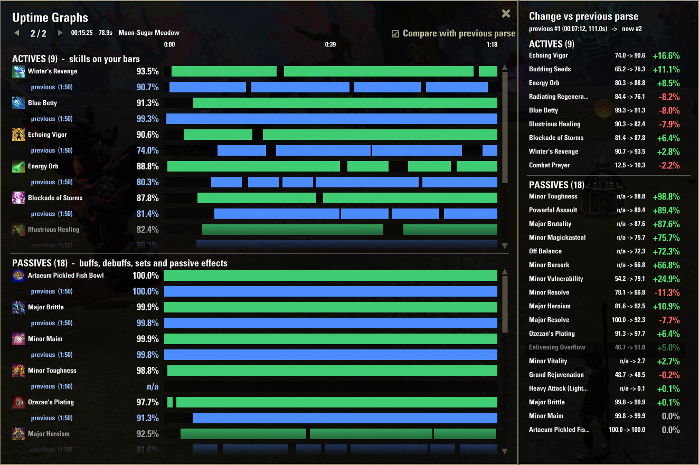

# Uptime Graphs

Displays a simple bar graph for each ability, active or passive, and how much of it was up during a combat encounter. Useful if you're trying to maximize enchants or passive uptimes. 

### Simple single fight report

### Comparison between the current and previous fight
